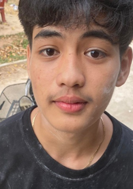
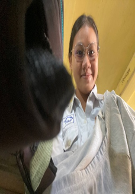
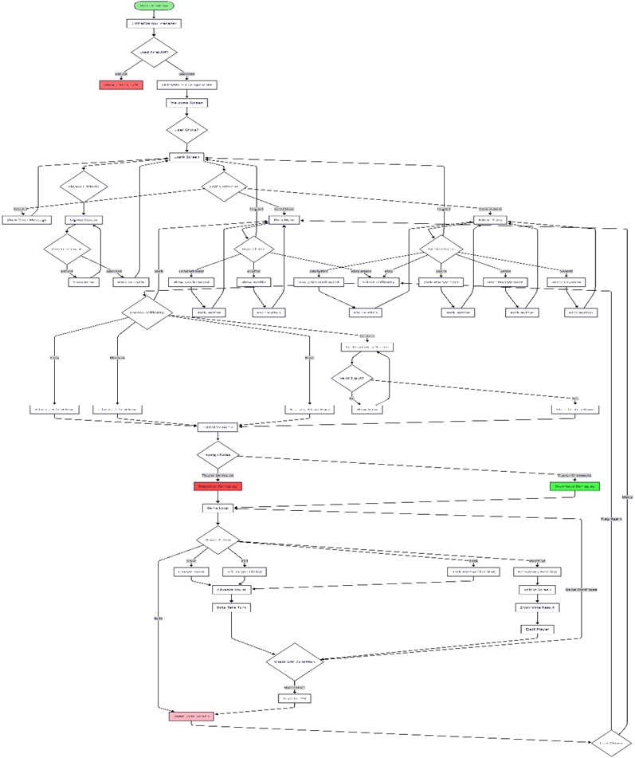
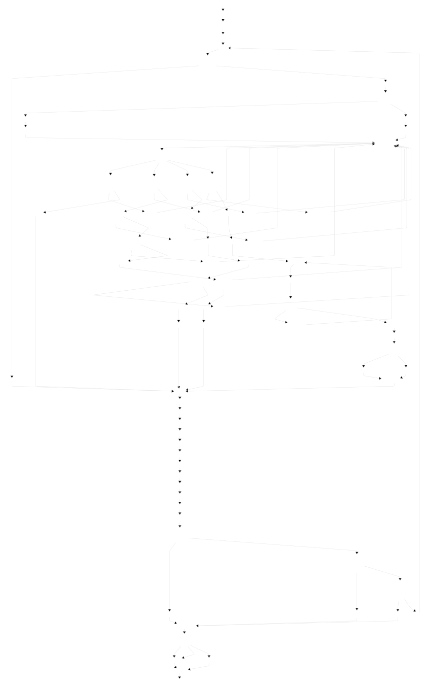
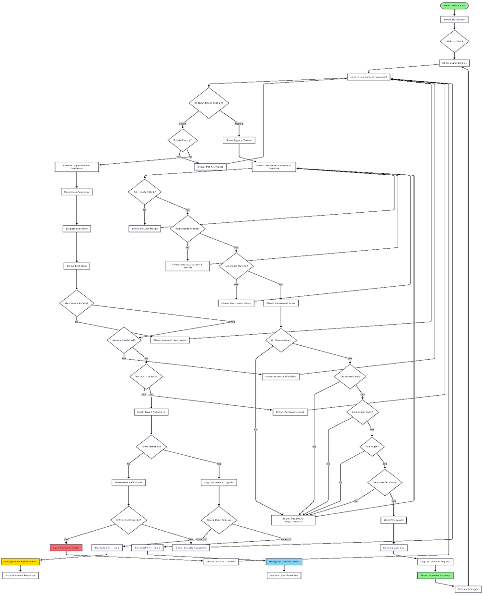
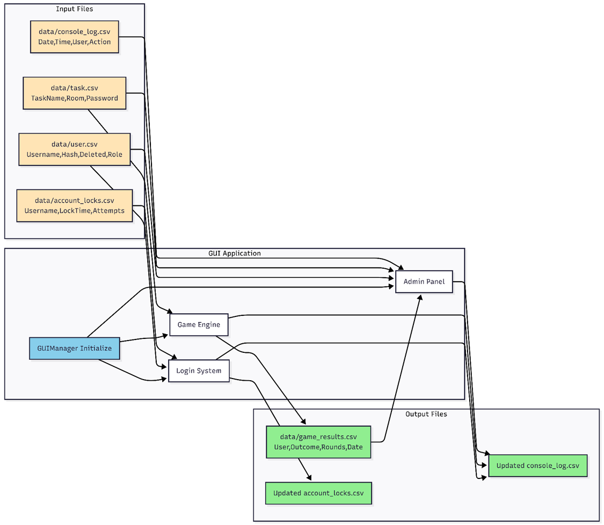
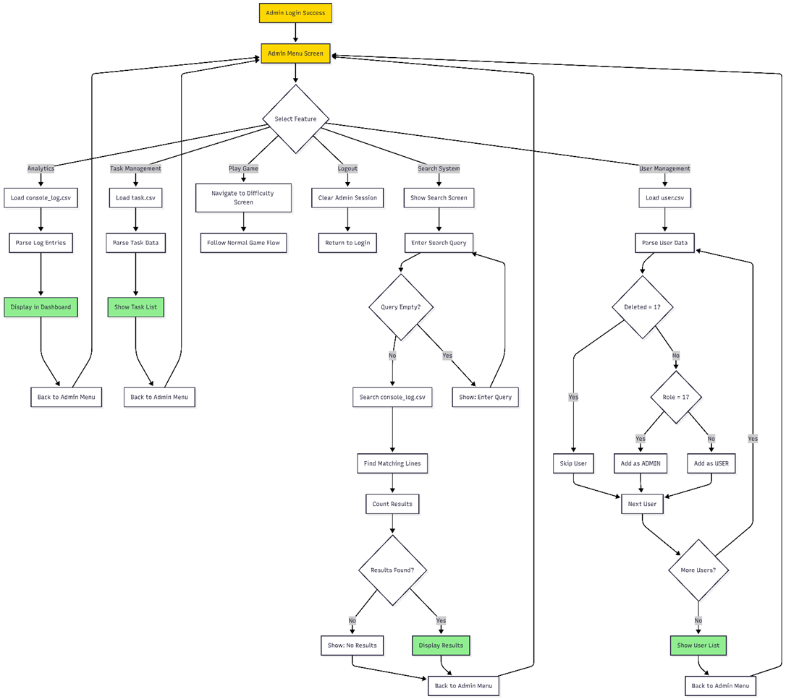

Department of Computer Science Data Structure and Algorithm
CS- DATA SCIENCE, Group 2
Project Report "Space Crew"
Lecture: Bou Channa
Group: 02
Submission Date: 16 December 2025

 
Table of Contents

1.	Team  Contributions
2.	 Project Overview
3.	Implementation
3.1	Core features
3.2	File IO and data management
3.3	Program Workflow
3.4	CRUD Operations
3.5	Security Implementation
3.6	Flow chart
4.	Challenge and Experience	
4.1. challenges
4.2 lesson-learn
4.3 Reflection
5.	Result
5.1	Key achievements
5.2	Contribution from each team member
6.	Conclusion
7.	Appendixes
7.1	Technical Specifications
7.2	References
7.3	Github Repository

 

1.	Team Members
Seng Chansreybopha: Manager	
Yann  Laie: Data and resource
Chhim Soksambath: Core Game Flow and GUI Handler
Yuth Molika: Player and mission	
Leang sivming: Data Sturcture

Main Responsibility

Chhim Soksambath:
-	Core Game Flow
-	Map
-	Code merger
-	GUI 
-	Test and debug.etc.

Leang sivming:
-	Linked list
-	Queue
-	Stack
-	Test 

Seng Chansreybopha:
-	Github Repository Manager
-	Task allocator
-	Player movement logic
-	Bot movement logic

Yann Laie:
-	Read/write data to csv
-	Leaderboard
-	Test

Yuth Molika:
-	Player role 
-	Missions 
-	Difficulty
-	Test 

2.	Project Overview
	Project Name: Space Crew (Among Us - C++ Edition)
	Project Type: 2D Social Deduction Game with GUI
	Programming Language: C++ with SFML 3.0.2 for graphics
	Project Description: Space Crew is a multiplayer-inspired social deduction game where players work as a team to complete tasks on a spaceship. However, among the crew members are impostors trying to eliminate everyone. The game features a full graphical user interface with login system, multiple game modes, admin panel, and comprehensive data management.
•	Singly Linked List (SLL): Used for managing player task assignments dynamically. Each node contains a task name, and tasks can be added or removed as players complete them during gameplay.
•	Stack: Implements mission history tracking for players. Each completed task is pushed onto the stack, allowing players to view their recent accomplishments in reverse chronological order.
•	Queue: Manages emergency meeting voting system. Votes are enqueued as players cast them, then processed in order to determine who gets ejected from the spaceship.
•	Graph (Map): Used for fast lookup of user credentials, task passwords, and leaderboard statistics. Provides O(1) average-case access time for critical game operations.
•	Bubble sorting algorithm: (for leaderboard sorting)
•	File I/O: (for user account info/log, leaderboard, game result , tasks, tasks password and map room save/load)
•	GUI implementation: using SFML version3.0.2 and CMake

3. Implementation
3.1 Core Features:
	Authentication System:
•	Secure login with password hashing 
•	Account creation with validation (8+ chars, uppercase, lowercase, digit, special character)
•	Account locking after 3 failed attempts
•	Admin and user role separation
•	Console logging of all login/signup activities
	Gameplay Features:
•	Dynamic role assignment (1 impostor among 10 players)
•	Task completion system with password verification
•	Room navigation with map system (10 interconnected rooms)
•	Kill mechanics with cooldown timer for impostors
•	Emergency meeting system with 30-round cooldown
•	Voting system to eject suspicious players
•	Multiple difficulty levels (Easy, Medium, Hard, Custom)
	Admin Panel:
•	Analytics dashboard showing console log activity
•	Task management (view all tasks from CSV)
•	User management (view all registered users with roles)
•	Search system for console logs
•	Full access to all player features
	User Features:
•	Leaderboard showing top 10 players by win points
•	User profile with statistics (games played, wins, losses, win rate)
•	Recent game history display
•	Difficulty selection before each game

3.2 File I/O and Data Management
The system uses CSV files for persistent data storage:
• user.csv: Stores username, hashed password, deleted status, and role
• task.csv: Contains task names.
• taskpw.csv: Contains task password.
• task.csv: Contains task assigned rooms.
• game_results.csv: Records username, outcome.
• console_log.csv: Logs all system activities with timestamp.
• account_locks.csv: Tracks failed login attempts and account locks.

3.3 Program Workflow
1. Application Start:
Initialize SFML window and GUI components → Load Arial font → Display welcome screen
2. Authentication:
User clicks to start → Login screen appears → Enter credentials → Validate against user.csv → Check account status → Grant access based on role (Admin/User)
3. Game Setup:
Select difficulty → Configure game parameters → Initialize 10 players (1 user + 9 bots) → Randomly assign 1 impostor → Assign tasks to crewmates
4. Gameplay Loop:
Display game UI → Player takes action (Move/Task/Kill/Meeting) → Bots execute AI logic → Check win conditions → Advance to next round OR End game
5. Game End:
Save results to CSV → Display victory/defeat screen → Show statistics → Option to play again or return to menu

3.4 CRUD Operations
	CREATE:
New user accounts via signup system • Game results automatically saved after each match • Console log entries for every system activity
	READ:
User credentials during login • Task data for assignment • Leaderboard statistics • User profile information • Admin analytics data
	UPDATE:
Failed login attempt counter • Account lock status • Task completion status during gameplay
	DELETE:
Soft delete of user accounts (marked as deleted in CSV)
Hard delete of user accounts (delete permanently)

3.5 Security Implementation
• Password hashing before storage • Password masking in GUI (shows asterisks) • Account locking mechanism after 3 failed attempts • Input validation for all user inputs • Duplicate username prevention • Console logging for security auditing

3.6 Flow Chart
1.	Overall System Architecture

2.	Gameplay Logic

3. Login & Authentication System

4. Data Flow & File System

5. Admin Features

4. Challenges and Experience
4.1 Challenges
I.	GUI Implementation:	SFML 3.0.2 had significantly different syntax from version 2.x, making it difficult to find proper documentation. We had to experiment extensively to understand the new event handling system and rendering pipeline.
II.	Scope Management:	The project grew much larger than initially anticipated. Integrating console-based game logic with a full GUI system while maintaining data persistence proved to be a significant challenge.
III.	Bug Complexity:	Some bugs were deeply rooted in data structure management. For example, CSV header rows not being skipped caused login failures that took hours to debug.
IV.	File Path Issues:	The GUI executable ran from a different directory than the console version, causing file not found errors. We solved this by copying data files to the build directory.

4.2 Lessons Learned
I.	Plan Architecture First: Designing the overall system structure before coding saves significant debugging time later.
II.	Test Early and Often: Testing console logic separately before GUI integration would have prevented many issues.
III.	Version Control Discipline: Proper Git workflow and branching strategy is essential for team projects.
IV.	Documentation Matters: Keeping track of file formats, data structures, and system design decisions helps onboarding and debugging.
V.	Communication is Key: Regular team meetings and clear task assignments prevent duplicate work and conflicts.

4.3 Reflection
This project significantly improved our problem-solving abilities and teamwork skills. We learned to debug systematically, starting with data structures rather than GUI symptoms. The experience taught us resilience and patience - software development is iterative, and persistence through setbacks is essential.
Working with SFML 3.0.2 and modern C++ challenged us to read documentation carefully and experiment when official resources were scarce. We developed better code organization habits and learned the importance of separating concerns (game logic vs. presentation layer).

5. Result
5.1 Key Achievements
✓ Full GUI Implementation: Smooth SFML-based interface with responsive buttons, text boxes, and visual feedback
✓ Complete Authentication System: Secure login/signup with password hashing and account management
✓ Dynamic Gameplay: Fully functional game with role assignment, task system, voting, and win conditions
✓ Admin Panel: Comprehensive system administration tools for monitoring and management
✓ Data Persistence: All game results, user data, and logs properly saved to CSV files
✓ Multiple Data Structures: Successfully implemented and integrated SLL, Stack, Queue, and Hash Table
✓ User-Friendly Experience: Intuitive interface with clear visual feedback and error messages

5.2 Contribution from Each Member
Each team member successfully completed their assigned responsibilities. The project demonstrates effective collaboration, with code integration handled smoothly and all major features implemented. 

6. Conclusion
Space Crew successfully demonstrates the practical application of data structures and algorithms in a real-world project. The game combines multiple data structures (Linked List, Stack, Queue, Hash Table) with file I/O operations, GUI programming, and secure user authentication.
Despite facing significant challenges with GUI integration and scope management, the team persevered and delivered a fully functional product. The project enhanced our understanding of C++ programming, data structure implementation, version control, and team collaboration.
This experience has prepared us for more complex software engineering challenges in the future, teaching us the importance of careful planning, systematic debugging, and effective communication in team projects.

7. Appendix
7.1 Technical Specifications
	Programming Language: C++17
	Graphics Library: SFML 3.0.2
	Build System: CMake 4.2.1
	Compiler: MinGW-w64 13.1.0
	Platform: Windows 10/11
	Total Lines of Code: ~3000+ lines
	Number of Source Files: 15+ header files, main.cpp, GUIManager.hpp

7.2 References
	SFML Documentation: https://www.sfml-dev.org/documentation/3.0.0/ 
	C++ Reference: https://en.cppreference.com/   
	CMake Documentation: https://cmake.org/documentation/

7.3 GitHub Repository
Project Repository: https://github.com/Bopha222/Space-Crew

----- End of Report -----

